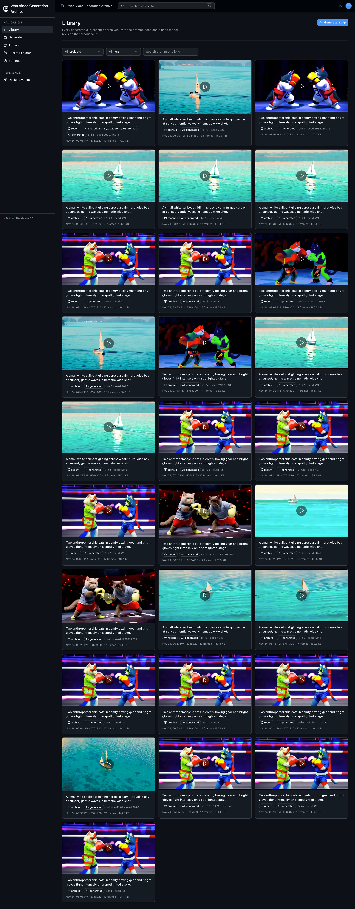
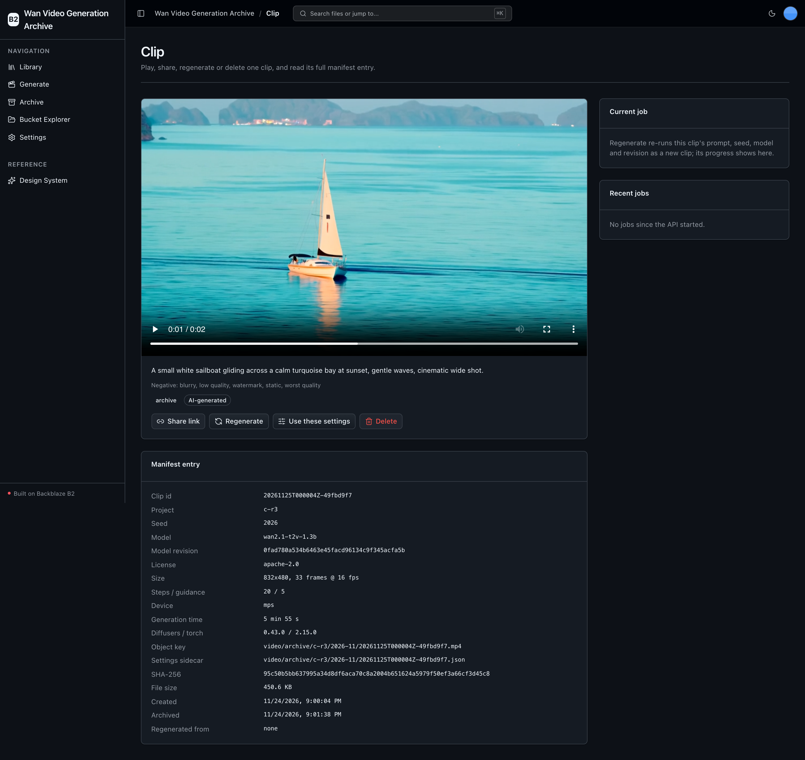
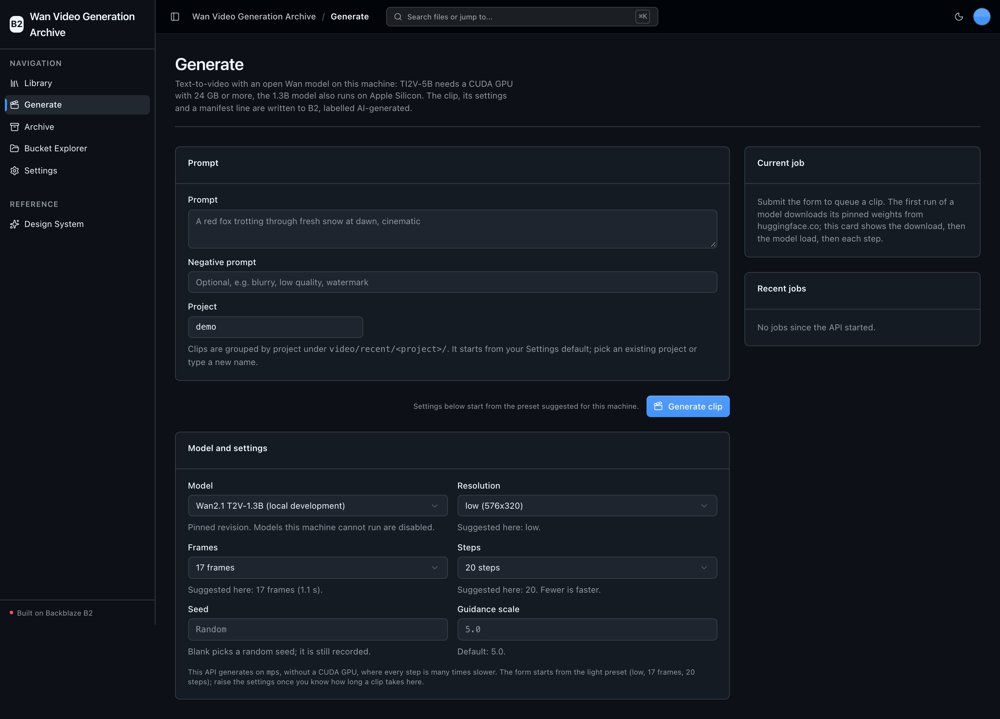
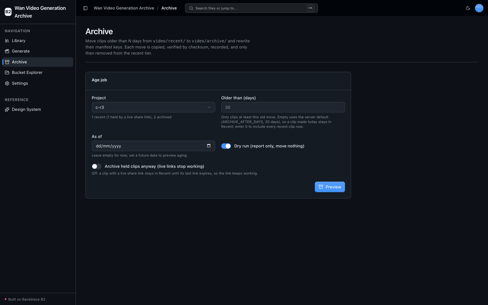

<!-- last_verified: 2026-11-24 -->
<!-- gen:begin readme-header -->
# Wan Video Generation Archive

Every generated clip stays findable, reproducible and labelled as it ages. Generate short videos with Wan2.2 TI2V-5B on one GPU and keep every clip in Backblaze B2 with its prompt, seed, pinned model revision and license, archived by age and shared through expiring links.

Built for developers and AI coding agents: the scaffolding, the storage
wiring and the agent-facing docs are already done, so you start on your
app's own features instead of rebuilding the same shell. Storage is
**[Backblaze B2](https://www.backblaze.com/sign-up/ai-cloud-storage?utm_source=github&utm_medium=referral&utm_campaign=ai_artifacts&utm_content=b2ai-wan-video-generation-archive)**, integrated through the S3-compatible API.

**What you get out of the box:**
- Full-stack dashboard UI (Next.js 16, React 19, Tailwind v4, shadcn/ui, TanStack Query)
- Clip Generation — Wan2.2 text-to-video on one GPU, labelled AI-generated
- Clip Library — browse clips by project and tier with their manifest entries
- Prompt-and-Seed Manifest — per-project JSONL with prompt, seed, model revision, license and checksum
- Archive Age Job — move older clips to the archive prefix and update manifest keys
- Share Links — expiring presigned links for recent or archived clips
- Regenerate from Manifest — re-run a clip from its recorded prompt, seed and revision
- Bucket Explorer — browse, preview and download every object in the bucket
- Metadata Extraction — image dimensions, EXIF, PDF info, checksums in the explorer
- Settings — theme, default project and default share link lifetime
- Backend with a strict layered architecture and structural tests (FastAPI, Python 3.12+, boto3, Pydantic v2, Diffusers, PyTorch, imageio-ffmpeg)
- Agent-optimized docs — your AI coding agent can read the repo and start contributing immediately
<!-- gen:end readme-header -->

This sample implements the generation-output lifecycle from the
[B2 generative media reference architectures](https://github.com/backblaze-b2-samples/b2-generative-media-reference-architectures)
for video: generate on your own GPU, record how each clip was made, age it into
an archive tier, and share it by signed link.

<!-- gen:begin readme-screenshots -->
## What it looks like

**Library**: every generated clip, recent or archived, with its prompt, seed, tier and AI-generated label, filterable by project and tier.



**Clip**: play one clip, share it by expiring link or regenerate it, and read its full manifest entry (seed, pinned model revision, license, checksum, B2 keys).



**Generate**: queue a text-to-video job on a pinned Wan model, with resolution, frames, steps and seed suggested for this machine.



**Archive**: move clips older than N days from the recent tier to the archive prefix, with a dry-run preview and live share links respected.


<!-- gen:end readme-screenshots -->

## How it works

```
prompt + seed ──> Wan2.2 TI2V-5B (Diffusers, pinned revision, one GPU)
                     │ frames
                     ▼
              MP4 encode (bundled ffmpeg) + AI-generated container tags
                     │
                     ▼ put_object (S3-compatible API)
   video/recent/<project>/<YYYY-MM-DD>/<clip_id>.mp4  + .json settings sidecar
   video/manifests/<project>.jsonl   one line per clip: prompt, seed, model,
                                     revision, license, SHA-256, current key
                     │ age job: copy -> verify -> rewrite manifest -> delete
                     ▼
   video/archive/<project>/<YYYY-MM>/<clip_id>.mp4  (+ .json)
                     │
                     ▼ presigned GET (inline video/mp4, 1 min to 7 days)
               share link that plays in any browser
```

Every clip is labelled AI-generated three ways: in its S3 object metadata
(`ai-generated: true`), in the MP4 container tags (`ai_generated=true`,
`ai_label=AI-generated`), and in its manifest line. Clips enter B2 only through
the model, so every clip has a manifest entry.

## Where B2 fits

Generated video piles up fast, and a clip without its prompt, seed and exact
model version cannot be explained, reproduced or safely shared once it leaves
the working folder. B2 holds the clips, their settings and the manifests in one
bucket, so outputs stay findable after archiving, and presigned URLs share a
clip without making the bucket public. Archiving is a server-side copy inside
the bucket: no bytes travel back through the GPU host.

| Operation | Why |
| --- | --- |
| `put_object` | store a clip (`video/mp4`), its settings sidecar and the rewritten manifest |
| `get_object` | read a project manifest or a settings sidecar |
| `head_object` | verify an archive copy (size, `sha256` metadata) before removing the recent copy; `/health` |
| `copy_object` | move a clip to `video/archive/` with `MetadataDirective=COPY`, keeping its labels |
| `delete_object` | drop the recent copy after a verified move, or delete a clip |
| `list_objects_v2` | list project manifests and back the full-bucket explorer |
| presigned GET | share links and explorer previews and downloads |

One `boto3` client (`services/api/app/repo/b2_client.py`) carries the user agent
`b2ai-wan-video-generation-archive`, and its endpoint is derived from
`B2_REGION`.

## Model and license

| `WAN_MODEL` | Hugging Face repository | Pinned revision | License | Use |
| --- | --- | --- | --- | --- |
| `wan2.2-ti2v-5b` (default) | [Wan-AI/Wan2.2-TI2V-5B-Diffusers](https://huggingface.co/Wan-AI/Wan2.2-TI2V-5B-Diffusers) | `b8fff7315c768468a5333511427288870b2e9635` | Apache-2.0 | demo and validation; 24 fps; presets `low` 384x672, `480p` 480x832, `720p` 704x1280 |
| `wan2.1-t2v-1.3b` | [Wan-AI/Wan2.1-T2V-1.3B-Diffusers](https://huggingface.co/Wan-AI/Wan2.1-T2V-1.3B-Diffusers) | `0fad780a534b6463e45facd96134c9f345acfa5b` | Apache-2.0 | local development only; 16 fps; presets `low` 320x576, `480p` 480x832 |

- Weights load only from huggingface.co, at the pinned commit
  (`DiffusionPipeline.from_pretrained(repo, revision=<sha>)`). If `HF_ENDPOINT` is
  set to anything other than `https://huggingface.co`, the worker refuses to
  load. Neither model is gated, so `HF_TOKEN` is optional. Nothing from the model
  repositories (configs, example scripts, prompt extenders) is copied into this
  repo.
- **The repository license does not cover the model weights.** This repository
  is MIT-licensed; the Wan weights are distributed by their authors under their
  own license (Apache-2.0 for both pinned models). Review the model cards before
  you use generated output.
- Libraries: Diffusers, Transformers, Accelerate and boto3 are Apache-2.0;
  PyTorch is BSD-3-Clause; `imageio-ffmpeg` is BSD-2-Clause, and the static
  ffmpeg binary it bundles is licensed under the LGPL or the GPL depending on
  the build (the bundled builds include the GPL x264 encoder). Check those terms
  before you redistribute a build of this app.
- **Excluded on license grounds:** LTX-Video and LTX-2 are not offered, because
  their licenses restrict commercial use. The registry offers only Apache-2.0
  models, and a test asserts it.

## Quick Start

You need: Node.js >= 20, pnpm >= 10, Python >= 3.12, and a free
**[Backblaze B2 account](https://www.backblaze.com/sign-up/ai-cloud-storage?utm_source=github&utm_medium=referral&utm_campaign=ai_artifacts&utm_content=b2ai-wan-video-generation-archive)**.
To generate with the default TI2V-5B model you need a CUDA GPU with 24 GB or
more of VRAM; see [infra/gpu-vm/README.md](infra/gpu-vm/README.md) for a rented
GPU. For local development, the 1.3B model runs on smaller GPUs and, best
effort, on Apple Silicon (MPS). CPU works but is impractically slow for video.

**1. Run setup**

```bash
git clone https://github.com/backblaze-b2-samples/wan-video-generation-archive.git
cd wan-video-generation-archive
pnpm run setup
```

This copies `.env.example` to `.env` only when `.env` does not already exist,
installs workspace dependencies, creates `services/api/.venv` and installs the
locked API dependencies (no torch). Use the `pnpm run` form: `setup` and
`doctor` are built-in pnpm commands before pnpm 11.

**2. Add your B2 credentials**

Open `.env` in your editor. Then head to the
[Backblaze B2 dashboard](https://secure.backblaze.com/b2_buckets.htm?utm_source=github&utm_medium=referral&utm_campaign=ai_artifacts&utm_content=b2ai-wan-video-generation-archive) and:

<!-- gen:begin readme-credentials -->
1. **Create a bucket** and an **application key** with `Read and Write`
   permission, then paste each value into `.env`:
   - `B2_APPLICATION_KEY_ID` — B2 application key ID (**keyID** in the B2 console)
   - `B2_APPLICATION_KEY` — B2 application key (**applicationKey**), shown once at creation
   - `B2_BUCKET_NAME` — bucket unique name (**Bucket Unique Name** in the B2 console)
   - `B2_REGION` — the region inside the bucket's **Endpoint** (`s3.<region>.backblazeb2.com`); the S3 endpoint is derived from it

   B2 shows an application key once, at creation. The optional variables are
   documented in `.env.example` and in the delivery runbooks.
<!-- gen:end readme-credentials -->

> Want a walkthrough? See the docs for [creating a bucket](https://www.backblaze.com/docs/cloud-storage-create-and-manage-buckets) and [creating app keys](https://www.backblaze.com/docs/cloud-storage-create-and-manage-app-keys).

Keep the bucket **private**: share links are presigned, so nothing needs to be public.

**3. Install the model stack**

```bash
services/api/.venv/bin/pip install -r services/api/requirements-model.txt
```

On a laptop, the Generate form pre-selects the 1.3B development model: the API
reports TI2V-5B as unavailable without a CUDA GPU of 24 GB or more, greys it out
and refuses it before anything downloads. Set `WAN_MODEL=wan2.1-t2v-1.3b` in
`.env` to make the CLI use it too. The first generation downloads the pinned
weights into `HF_HOME`, which takes several minutes; the job card shows the
download, then the model load, then each step.

**4. Run it**

```bash
pnpm dev
```

Web at `localhost:3000`, API at `localhost:8000` (Swagger UI at `/docs`). Open
**Generate**, keep the defaults, enter a prompt such as "A red fox trotting
through fresh snow at dawn, cinematic", and submit. The panel beside the form
shows the download, the model load and each denoising step (it picks the job up
again after a reload); when it finishes, the page opens the clip: the player, the
manifest entry, **Share link**, **Regenerate**, **Archive...** and **Delete**. Off
CUDA (a Mac) the form starts from a light preset (low, 17 frames, 20 steps).
**Archive** runs the age job (dry run by default; set *As of* to a future date to
preview aging, or *Older than* to 0 to include a clip made today). A clip with a
live share link stays in Recent until the link expires, so the link keeps working;
turn on *Archive held clips anyway* to move it now (its live links stop working).

The same operations work headless, which is how the GPU host and a cron age job use it:

```bash
cd services/api
.venv/bin/python scripts/wan_archive.py generate --project demo --prompt "A red fox trotting through fresh snow at dawn, cinematic" --seed 42
.venv/bin/python scripts/wan_archive.py age --project demo --dry-run --as-of 2027-01-01
.venv/bin/python scripts/wan_archive.py share --project demo --clip-id <clip_id> --ttl 3600
.venv/bin/python scripts/wan_archive.py regenerate --project demo --clip-id <clip_id>
```

`pnpm dev` runs the `pnpm run doctor` preflight first, which catches the usual
setup problems (Node or Python version, missing venv, placeholder `.env`, busy
ports). Local scripts run on macOS, Linux and WSL2; see
[docs/verification.md](docs/verification.md#local-environments).

## GPU validation

The 24 GB claim from the model card is a recorded gate, not an assumption. On
the GPU host, `pnpm gpu:preflight` runs the demo preset (480p, 49 frames, 30
steps) with CPU offload off, records `torch.cuda.max_memory_allocated()`, and
fails above 24 GiB, reporting whether `WAN_CPU_OFFLOAD=on` brings it under.
`RUN_LIVE_B2_TESTS=1 pnpm test:live:gpu` then runs the full self-test against a
real bucket: generate, age, share, verify checksums and labels, regenerate.

| Date | GPU | Model revision | Preset | Peak VRAM | Generation seconds | Age job result | Share link opened |
| --- | --- | --- | --- | --- | --- | --- | --- |
| | | | | | | | |

## When to use

Use this sample when you run an open video model on your own GPU and need every
output to stay traceable as it ages: which prompt, seed and model revision made
it, where it lives now, and who can see it. Clone it, point it at your bucket,
and extend the registry or the age policy.

## When not to use

It is not a hosted video service. It has no user accounts, authentication,
tenant isolation, batch scheduling, multi-GPU support, transcoding or
streaming, and it does text-to-video only (no image conditioning). Jobs run one
at a time in the API process and are lost on restart (their stored clips are
not). Before running an adapted version in production you own its security,
operations, capacity and compliance decisions.

## Core Features

<!-- gen:begin readme-core-features -->
- [Clip Generation](docs/features/clip-generation.md) — Wan2.2 text-to-video on one GPU, labelled AI-generated
- [Clip Library](docs/features/clip-library.md) — browse clips by project and tier with their manifest entries
- [Prompt-and-Seed Manifest](docs/features/manifest.md) — per-project JSONL with prompt, seed, model revision, license and checksum
- [Archive Age Job](docs/features/archive-age-job.md) — move older clips to the archive prefix and update manifest keys
- [Share Links](docs/features/share-links.md) — expiring presigned links for recent or archived clips
- [Regenerate from Manifest](docs/features/regeneration.md) — re-run a clip from its recorded prompt, seed and revision
- [Bucket Explorer](docs/features/file-browser.md) — browse, preview and download every object in the bucket
- [Metadata Extraction](docs/features/metadata-extraction.md) — image dimensions, EXIF, PDF info, checksums in the explorer
- [Settings](docs/features/settings.md) — theme, default project and default share link lifetime
<!-- gen:end readme-core-features -->
- [Design System](docs/design-system.md): tokens, primitives, and inline `ErrorState` / `EmptyState` patterns. Live preview at `/design`.
- Centralized data layer: every fetch goes through TanStack Query hooks in `apps/web/src/lib/queries.ts`; the types, route registry and query keys underneath are generated from the API contract by `pnpm gen:api`.
- Checked local API contract: [`docs/api/openapi.json`](docs/api/openapi.json) plus `pnpm contract:check`.
- Structural tests: layering rules, import boundaries, SDK containment (boto3 only in `repo/`, torch imported lazily) and file-size limits.
- `/health` (B2 connectivity) and `/metrics` (Prometheus counters, including `clips_generated_total`).
- Per-IP rate limiting; see [SECURITY.md](docs/SECURITY.md).

## Tech Stack

- TypeScript, Next.js 16, React 19, Tailwind v4, shadcn/ui, TanStack Query
- Python 3.12+, FastAPI, Pydantic v2, boto3
- Diffusers and PyTorch (in `requirements-model.txt`), `imageio-ffmpeg` for MP4
- Backblaze B2 (S3-compatible object storage)
- pnpm workspaces (monorepo)

## Commands

<!-- gen:begin readme-commands -->
| Command | What it does |
| --- | --- |
| `pnpm run setup` | One-time cold start: copy `.env.example` → `.env` (only if missing), install workspace deps, create the backend venv, install locked API deps |
| `pnpm dev` | Start frontend + backend (runs the `pnpm run doctor` preflight first) |
| `pnpm wait-ready` | Block until the running web + API answer, print one line, exit 0/1 — use instead of sleeping before driving the app |
| `pnpm contract:export` | Export the FastAPI OpenAPI contract into `docs/api/openapi.json` |
| `pnpm contract:check` | Verify the exported contract and the generated client routes agree, both ways |
| `pnpm gen:api` | Regenerate the shared types, the client route registry and the query-key factory from the exported contract |
| `pnpm gen:docs` | Regenerate the marker-delimited doc regions from `docs/exec-plans/sample.json` |
| `pnpm gen:check` | Fail if any generated file or doc region is stale (first step of `pnpm verify:web`) |
| `pnpm verify` | Credential-free pre-PR suite — runs `check:agent-docs`, `verify:api`, then `verify:web` |
| `pnpm verify:full` | `pnpm verify` plus Playwright E2E; needs a live local stack, real `.env`, a free web port, and Chromium |
| `pnpm test:verify` | Run throwaway verification specs from `apps/web/e2e/verify/` against the app, with the shared browser fixtures |
<!-- gen:end readme-commands -->

`pnpm verify` is the gate to run before opening a PR. It needs
`services/api/.venv` from `pnpm run setup`, but no B2 credentials, GPU or
browser, and it breaks down into `pnpm verify:api` (backend lint, tests,
structure), `pnpm verify:web` (frontend lint, unit tests, typecheck + build),
and `pnpm check:agent-docs` (agent-doc drift). On the GPU host,
`pnpm gpu:preflight` and `pnpm test:live:gpu` are the model gates.

For the full command reference, see
[docs/dev-workflows.md](docs/dev-workflows.md#commands); for what each gate
checks, see [docs/verification.md](docs/verification.md).

## Deployment

The API needs a CUDA host to generate, so this sample ships no Vercel or
Railway configuration.

<!-- gen:begin readme-deploy-button -->
_This app does not ship a one-click deploy button._
<!-- gen:end readme-deploy-button -->

Run both services on the GPU host and reach the web UI through an SSH tunnel;
the step-by-step runbook (driver check, venv, `HF_HOME` on local disk, tunnel)
is [infra/gpu-vm/README.md](infra/gpu-vm/README.md). The API is unauthenticated
and bucket-wide, so never expose it publicly, and use a dedicated bucket and key.

## Documentation Map

<!-- gen:begin readme-doc-map -->
| Doc | Purpose |
| --- | --- |
| [AGENTS.md](AGENTS.md) | Agent table of contents — start here |
| [ARCHITECTURE.md](ARCHITECTURE.md) | System layout, layering, data flows |
| [docs/features/](docs/features/) | Feature docs (clip generation, clip library, prompt-and-seed manifest, archive age job, share links, regenerate from manifest, bucket explorer, metadata extraction, settings) |
| [docs/design-system.md](docs/design-system.md) | Design tokens, primitives, loader, error/empty states |
| [docs/app-workflows.md](docs/app-workflows.md) | User journeys |
| [docs/dev-workflows.md](docs/dev-workflows.md) | Engineering workflows, command index, releases |
| [docs/verification.md](docs/verification.md) | What each gate checks, and failure recovery |
| [docs/frontend-conventions.md](docs/frontend-conventions.md) | Frontend conventions, screens, data fetching |
| [docs/SECURITY.md](docs/SECURITY.md) | Security principles |
| [docs/RELIABILITY.md](docs/RELIABILITY.md) | Reliability expectations |
| [docs/api/openapi.json](docs/api/openapi.json) | The checked-in API contract the client seam is generated from |
| [docs/exec-plans/](docs/exec-plans/) | Execution plans, tech debt, and the sample manifest |
<!-- gen:end readme-doc-map -->

## FAQ

**What does this sample do?**
It generates short videos with an open Wan model on your own GPU and stores
each clip in [Backblaze B2](https://www.backblaze.com/cloud-storage?utm_source=github&utm_medium=referral&utm_campaign=ai_artifacts&utm_content=b2ai-wan-video-generation-archive)
with a manifest entry that records its prompt, seed, pinned model revision,
license and checksum. An age job moves older clips to an archive prefix, and
any clip can be shared through an expiring link.

**Why pin a model revision?**
A model id alone can point at different weights tomorrow. The 40-hex revision
in the manifest names the exact weights, and Regenerate refuses an entry whose
revision is no longer in the registry.

**Does Regenerate reproduce a clip exactly?**
Same prompt, seed, settings and revision give the same initial noise. Pixel
output can still differ slightly across GPUs and library versions, so the
manifest also records the device and the Diffusers and PyTorch versions.

**Why not LTX-Video?**
Its license restricts commercial use. This sample only offers Apache-2.0 models.

**Does archiving re-upload the video?**
No. It is a server-side copy inside the bucket, verified by size and SHA-256
before the recent copy is removed.

**Is it free?**
The code is MIT-licensed, the models are Apache-2.0, and a free B2 account is
enough to try it. You pay for your own GPU time.

**Where do I get help or report bugs?**
Report repository defects through
[GitHub Issues](https://github.com/backblaze-b2-samples/wan-video-generation-archive/issues).
For B2 account, billing, service or API help, use
[Backblaze Support](https://www.backblaze.com/help).

## Maintenance and support

Backblaze maintains this open-source sample to help developers get started with
B2. Production use is possible with caution and requires your own validation.
It is not covered by the Backblaze service level agreement, and no SLA is
provided for the repository software; any B2 service or support commitments
are governed separately by the applicable Backblaze terms and support plan.

## Contributing

Start with [AGENTS.md](AGENTS.md). For local commit hooks, follow
[the pre-commit workflow](docs/verification.md#pre-commit).

## License

MIT License, see [LICENSE](LICENSE). The license covers this repository's code
only, not the model weights or the bundled ffmpeg binary; see
[Model and license](#model-and-license).

## Related projects

- [B2 generative media reference architectures](https://github.com/backblaze-b2-samples/b2-generative-media-reference-architectures): the architecture this sample implements.
- [flux-b2-generation-output-lifecycle](https://github.com/backblaze-b2-samples/flux-b2-generation-output-lifecycle): the same output lifecycle for generated images.
- [video-dubbing-b2-language-variants](https://github.com/backblaze-b2-samples/video-dubbing-b2-language-variants): language variants of a video, stored and served from B2.
- Built from the [vibe-coding-starter-kit](https://github.com/backblaze-b2-samples/vibe-coding-starter-kit) template.
